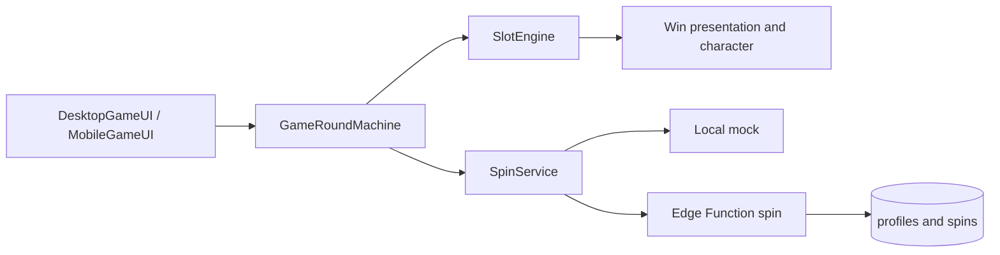
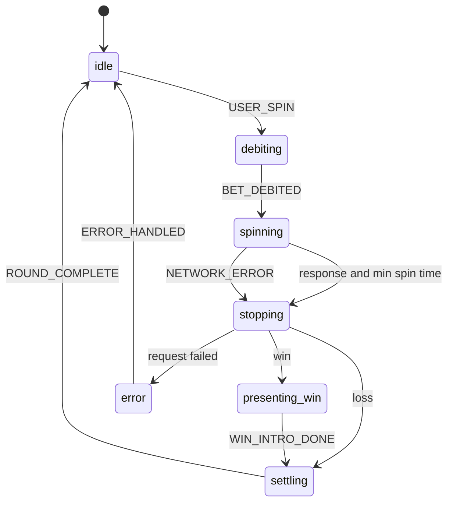

# Slot Machine

A browser slot demo: a 3×4 fruit grid rendered on canvas, with the round driven by a finite state machine and the outcome resolved either locally or on a Supabase Edge Function.

**[Play the live demo](https://geraldikus.github.io/SlotMachine/)**


This is an entertainment demo. The currency is **FUN**, not real money. Outcomes come from shared reel strips and a paytable. The same math runs in the browser mock and on the server.

## Features

- Desktop and mobile layouts, switched at a 1024px breakpoint
- Manual spin and auto-spin
- Win line highlight, win banner, and a Spine character reaction
- Lottie launch screen
- Sound with a mute control
- Rendering pauses when the tab is hidden and resumes after a lost WebGL context
- Two spin sources: a local mock, or a server round that owns the balance

## Tech stack

| Area | Choice |
| --- | --- |
| Language | TypeScript |
| Build | Vite |
| Rendering | PixiJS 8 |
| Motion | GSAP, Spine (`@esotericsoftware/spine-pixi-v8`), Lottie |
| Backend | Supabase Auth, Postgres, Edge Functions |
| Tests | Vitest |

## Game rules

The grid is 3 visible rows by 4 reels. Each reel has a strip of 24 symbols. A spin result is four stop indices. The visible window is the stop index and the next two symbols, wrapping around the strip. Three horizontal paylines pay three or four of a kind in a row from either end. `A A A ?` and `? A A A` pay. `A A ? A` does not. Dark and light berries are different symbols. A column of three identical symbols pays the three-of-a-kind multiplier. Reels 1 and 4 each contain one run of three berries, so a full column can land.

| Symbol | 3 of a kind | 4 of a kind |
| --- | --- | --- |
| Strawberry | ×5 | ×20 |
| Red cherry | ×3 | ×10 |
| Raspberry | ×2 | ×8 |
| Black cherry | ×3 | ×10 |
| Blackberry | ×2 | ×6 |
| Light berry | ×2 | ×6 |

A line pays `bet × multiplier`. Several lines on one spin add up. The Paytable button shows those multipliers in FUN for the current bet.

Bets are a fixed list: 1.5, 3, 5, 8, 10, 15, 20, 30, 50 FUN. A new session starts at 1000 FUN.

Mock mode draws stops locally. Supabase mode receives the stops from the Edge Function. The client lands each reel on its stop index and checks that the visible window matches `matrixFromStops`.

## Architecture

The UI sends a spin. `GameRoundMachine` is the only place that advances the round. It asks `SlotEngine` to move the reels and `SpinService` for a result, then emits effects (`start_reels`, `stop_reels`, `show_win`, `show_error`) for the scene to play. Rendering does not decide whether the round can stop, pay, or refund.



| Folder | Role |
| --- | --- |
| `src/ui` | Desktop and mobile HUD, banners, sound, launch screen |
| `src/state` | Round state machine |
| `src/engine` | Reels, symbols, win-line overlay |
| `src/services` | Spin requests, round history, Supabase client, sound |
| `src/replay` | Round playback that does not touch the wallet |
| `src/round` | Shared round record and version constants |
| `src/logic` | Seeded random helpers used by round metadata |
| `src/layout` | Desktop and mobile layout profiles |
| `src/character` | Spine alien |
| `supabase/functions/_shared` | Reel strips, paylines, and paytable shared by the server and the client |
| `supabase/functions/spin` | Authoritative spin for the server source |

## Round state machine

Reels stay in motion until two things are true: the network answer has arrived, and at least two seconds have passed (`MIN_SPIN_MS`). A failed request refunds the bet and stops the reels on the previous stop indices. In Supabase mode an interrupt after the request was sent does not refund locally, because the server already applied the round.



Main events: `USER_SPIN`, `BET_DEBITED`, `NETWORK_RESPONSE`, `NETWORK_ERROR`, `MIN_SPIN_ELAPSED`, `REELS_STOPPED`, `WIN_INTRO_DONE`, `ROUND_COMPLETE`, `INTERRUPT`.

## Server spin

Switching to Supabase signs the player in anonymously and loads `profiles.balance`. Each spin calls the `spin` Edge Function:

1. Rejects an unknown bet or a balance that cannot cover it.
2. Draws four stop indices, reads the strip window, and evaluates the paylines.
3. Persists the round through the `apply_round` RPC. The response includes `stops`, the derived matrix, the win, the balance, the seed, and the steps.
4. Drops anonymous demo users and spin rows older than 24 hours.

`apply_round` accepts a win of zero or more and requires `steps[0].stops` to be four numbers. The published anon key is enough for the browser. Service-role keys stay on the server. The Edge Function calls `apply_round` with the service-role key, so the browser cannot write a round or a balance directly.

## Replay

Each completed round is stored in `public.rounds` for 24 hours: the bet, the win, a seed, `game_version`, `math_version`, and a `steps` array. A base game has one step. Later features such as free spins can append steps without changing the table.

The History button in the demo panel lists the player's own rounds. Replay plays `step.stops` through `ReplayPlayer`. It never debits, credits, or refunds the balance, and it does not call `SpinService`. The reels land on the stored stop indices, so the visible window matches the original round.

A round whose `game_version` or `math_version` is not in the client's supported list shows "Replay недоступен для этой версии игры". Older rounds saved before strip stops use that same message. A missing or expired id shows "Раунд не найден или истёк".

Mock mode keeps the same history in memory, so replay works without Supabase.

A demo panel (desktop practice panel, mobile popover) can switch the source and, in mock mode only, force the next spin to be slow or to fail.

## Getting started

Requirements: Node.js 20.

```bash
npm install
cp .env.example .env
npm run dev
```

The dev server opens [http://localhost:3000/SlotMachine/](http://localhost:3000/SlotMachine/). The app base path is `/SlotMachine/`, the same path GitHub Pages uses.

Without `VITE_SUPABASE_URL` and `VITE_SUPABASE_ANON_KEY` the game still runs on the local mock. Those variables are required only for the Supabase source. GitHub Actions reads them from repository secrets at build time.

```bash
npm test          # watch
npm run test:run  # once
npm run build     # tsc and Vite build
npm run preview   # serve dist
```

## Deployment

A push to `main` runs [`.github/workflows/deploy.yml`](.github/workflows/deploy.yml): install, build, and publish `dist` to the `gh-pages` branch.

Live demo: [https://geraldikus.github.io/SlotMachine/](https://geraldikus.github.io/SlotMachine/)
