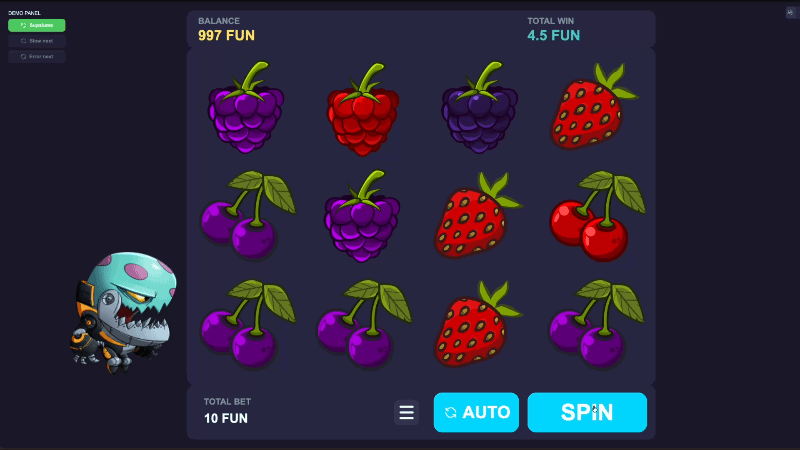
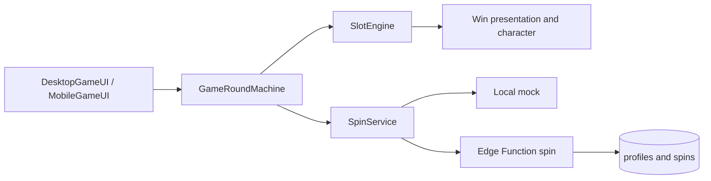
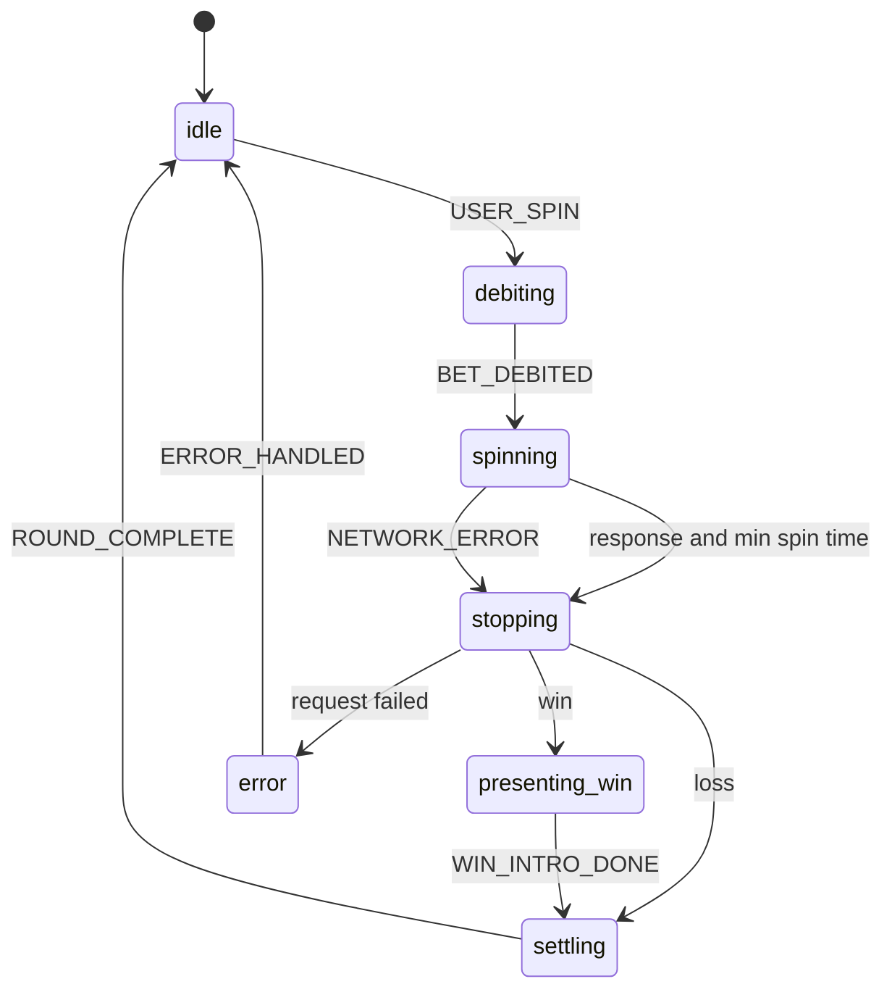

# Slot Machine

A browser slot demo: a 3×4 fruit grid rendered on canvas, with the round driven by a finite state machine and the outcome resolved either locally or on a Supabase Edge Function.

**[Play the live demo](https://geraldikus.github.io/SlotMachine/)**



This is an entertainment demo. The currency is **FUN**, not real money. Wins follow a fixed demo rule (every third spin), not a certified random-number generator.

## Features

- Desktop and mobile layouts, switched at a 1024px breakpoint
- Manual spin and auto-spin
- Win line highlight, win banner, and a Spine character reaction
- Lottie launch screen
- Sound with a mute control
- Rendering pauses when the tab is hidden and resumes after a lost WebGL context
- Two spin sources: a local mock, or a server round that owns the balance

## Tech stack

| Area | Choice |
| --- | --- |
| Language | TypeScript |
| Build | Vite |
| Rendering | PixiJS 8 |
| Motion | GSAP, Spine (`@esotericsoftware/spine-pixi-v8`), Lottie |
| Backend | Supabase Auth, Postgres, Edge Functions |
| Tests | Vitest |

## Game rules

The grid is 3 visible rows by 4 reels. A win is three identical symbols in a row on one horizontal line, or a full column of the same symbol. A winning spin pays `bet × 3`.

Bets are a fixed list: 1.5, 3, 5, 8, 10, 15, 20, 30, 50 FUN. A new session starts at 1000 FUN.

In both mock and Supabase mode, every third spin is a win. The client does not invent the matrix when the source is Supabase: the Edge Function builds it and `apply_spin` writes the balance.

## Architecture

The UI sends a spin. `GameRoundMachine` is the only place that advances the round. It asks `SlotEngine` to move the reels and `SpinService` for a result, then emits effects (`start_reels`, `stop_reels`, `show_win`, `show_error`) for the scene to play. Rendering does not decide whether the round can stop, pay, or refund.



| Folder | Role |
| --- | --- |
| `src/ui` | Desktop and mobile HUD, banners, sound, launch screen |
| `src/state` | Round state machine |
| `src/engine` | Reels, symbols, win-line overlay |
| `src/services` | Spin requests, Supabase client, sound |
| `src/logic` | Win-line detection and matrix generation |
| `src/layout` | Desktop and mobile layout profiles |
| `src/character` | Spine alien |
| `supabase/functions/spin` | Authoritative spin for the server source |

## Round state machine

Reels stay in motion until two things are true: the network answer has arrived, and at least two seconds have passed (`MIN_SPIN_MS`). A failed request refunds the bet and restores the previous matrix. In Supabase mode an interrupt after the request was sent does not refund locally, because the server already applied the round.



Main events: `USER_SPIN`, `BET_DEBITED`, `NETWORK_RESPONSE`, `NETWORK_ERROR`, `MIN_SPIN_ELAPSED`, `REELS_STOPPED`, `WIN_INTRO_DONE`, `ROUND_COMPLETE`, `INTERRUPT`.

## Server spin

Switching to Supabase signs the player in anonymously and loads `profiles.balance`. Each spin calls the `spin` Edge Function:

1. Rejects an unknown bet or a balance that cannot cover it.
2. Treats every third spin as a win and builds the matrix on the server.
3. Persists the round through the `apply_spin` RPC and returns the matrix, win, and new balance.
4. Drops anonymous demo users and spin rows older than 24 hours.

The published anon key is enough for the browser. Service-role keys stay on the server.

A demo panel (desktop practice panel, mobile popover) can switch the source and, in mock mode only, force the next spin to be slow or to fail.

## Getting started

Requirements: Node.js 20.

```bash
npm install
cp .env.example .env
npm run dev
```

The dev server opens [http://localhost:3000/SlotMachine/](http://localhost:3000/SlotMachine/). The app base path is `/SlotMachine/`, the same path GitHub Pages uses.

Without `VITE_SUPABASE_URL` and `VITE_SUPABASE_ANON_KEY` the game still runs on the local mock. Those variables are required only for the Supabase source. GitHub Actions reads them from repository secrets at build time.

```bash
npm test          # watch
npm run test:run  # once
npm run build     # tsc and Vite build
npm run preview   # serve dist
```

## Deployment

A push to `main` runs [`.github/workflows/deploy.yml`](.github/workflows/deploy.yml): install, build, and publish `dist` to the `gh-pages` branch.

Live demo: [https://geraldikus.github.io/SlotMachine/](https://geraldikus.github.io/SlotMachine/)
